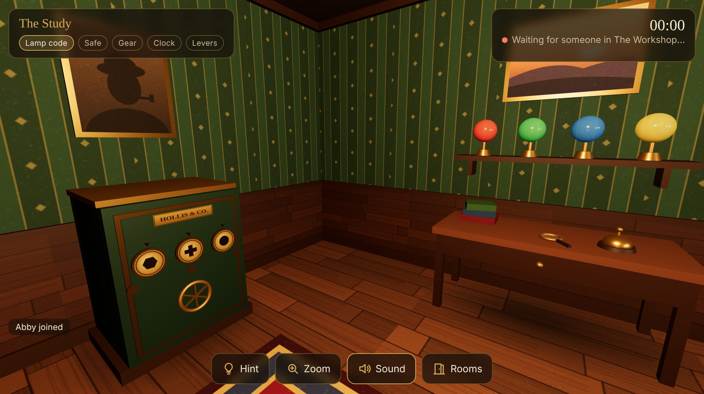

# The Clockmaker's Vault

A two-player co-op 3D puzzle game you can play inside a **Discord voice channel** (as a Discord Activity) or in any web browser.

> Old Hollis the clockmaker locked his life's work in a vault that only opens for *two minds working as one*.
> One of you wakes up in his **Study**, the other in his **Workshop**. You can't see each other's rooms,
> so you have to **talk**: describe what you see and crack it together.



## How it plays

Each player is in a different 3D room, and every puzzle needs information from one room and hands in the other.

| # | Puzzle | Study | Workshop |
|---|--------|-------|----------|
| 1 | **Lamp code** | Rings a bell and watches 4 lamps flash a colour sequence | Presses the coloured buttons in that order |
| 2 | **Safe** | Turns three symbol dials on an iron safe | Reads the symbols off a chalkboard |
| 3 | **Gear** | Takes a brass gear from the safe and fires it through the pneumatic tube | Catches it and fits it into the grandfather clock |
| 4 | **Clock** | Reads the time from a note found in the safe | Sets the clock hands to that time |
| 5 | **Levers** | Pulls the lever… | …at the *same moment* (within 1.5s) |

Then the wall between the rooms sinks into the floor, the treasure chest rises, and you finally see each other. 🎉

Every new case reshuffles the lamp colours, safe symbols and clock time, so you can replay it. A third person can join as a spectator and switch between rooms.

**Controls:** drag to look around · scroll or pinch to zoom · click/tap objects · arrow keys work too. Stuck? Press **Hint**.

## Play in your browser (quickest)

Requires [Node.js](https://nodejs.org) 20.12 or newer.

```bash
npm install
npm run build
npm start
```

Open <http://localhost:3000>, pick a name, and share the **invite link** from the lobby. To test it solo, open a second tab with `&player=2` added to the URL.

To play with someone on another computer, expose your server with a free tunnel and send them the link:

```bash
npx cloudflared tunnel --url http://localhost:3000
```

## Play inside Discord

Discord Activities are web pages that run inside a voice channel, so everyone in the call can play together.

1. **Create an app** at the [Discord Developer Portal](https://discord.com/developers/applications) → *New Application*.
2. **OAuth2 tab:** copy the *Client ID* and *Client Secret*. Add `https://127.0.0.1` as a redirect URI (a placeholder that Discord requires).
3. **Configure the game:**
   ```bash
   cp .env.example .env   # then paste your Client ID and Secret into .env
   npm run build          # the Client ID is baked into the client at build time
   npm start
   ```
4. **Expose it:** `npx cloudflared tunnel --url http://localhost:3000` and copy the `https://….trycloudflare.com` address.
5. **Activities → URL Mappings:** map the root prefix `/` to your tunnel host (without `https://`).
6. **Activities → Settings:** turn on *Enable Activities*.
7. In Discord, join a voice channel, click the **Activities** (🚀) button and pick your app. Your friend joins the same Activity from the voice channel.

While your app is unverified, Discord limits who can see and launch it. If your friend can't find or join it, add them to your app's **Team** in the Developer Portal.

The free tunnel URL changes every time you restart it. When it does, update the URL mapping. For a permanent home, deploy to any Node host that supports WebSockets (Render, Railway, Fly.io…) and point the mapping there.

## Development

```bash
npm run dev    # game server on :3000 + Vite dev server with hot reload on :5173
npm test       # puzzle-rule unit tests
```

```
server/
  index.js      Express + WebSocket server, Discord OAuth token exchange
  game.js       All puzzle rules and state (the server is the source of truth)
shared/
  constants.js  Colours, symbols, stages: shared by server and client
client/
  index.html    HUD, lobby and overlays
  src/main.js   Wires everything together
  src/world.js  Three.js renderer, look-around camera, click picking
  src/rooms.js  Builds both rooms and animates every prop from the game state
  src/textures.js  All textures, painted procedurally on <canvas> (no image files)
  src/audio.js  Synthesized sound effects (no audio files)
  src/hud.js    On-screen UI
  src/discord.js  Discord Embedded App SDK sign-in
test/
  game.test.js  Rules tests (node:test)
```

### Adding a puzzle

1. Add a stage name to `STAGES` in `shared/constants.js`.
2. Add the rule as an action in `ACTIONS` in `server/game.js` (per room), and a test in `test/game.test.js`.
3. Build the props in `client/src/rooms.js`: give them `this.interactive(obj, { id, room, label })` so clicks send `{ action: id }` to the server, and update them from state in `apply()`.
4. Add a hint for each room in `HINTS` in `client/src/hud.js`.
